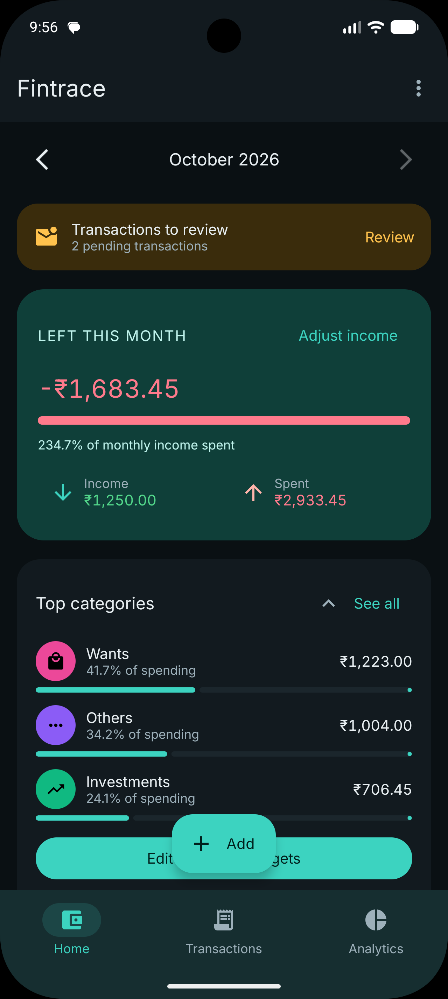
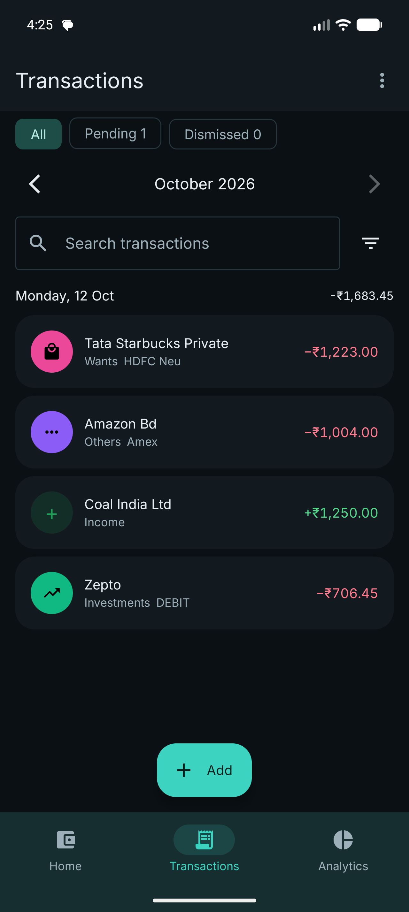
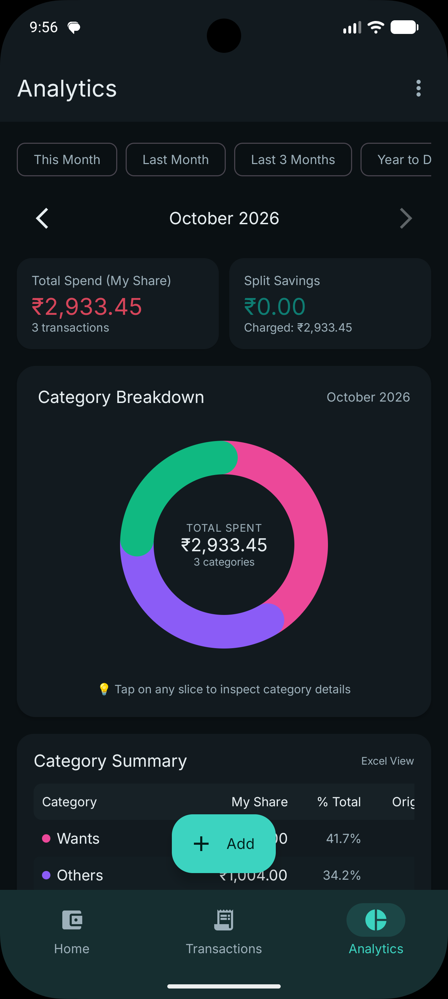

# Fintrace

**A native Android finance tracker that turns banking SMS alerts into reviewed transactions and makes shared expenses easier to understand.**

Built with Kotlin, Jetpack Compose, Material 3, and Room. Fintrace processes messages on the device, keeps your personal share separate from the full bill, and brings income and spending into a monthly dashboard. No bank login or backend account is required.

[Latest release](https://github.com/MrigankSingh10/Fintrace/releases/tag/v1.5.1) · [Getting started](#getting-started) · [Architecture](docs/ARCHITECTURE.md) · [Testing](TESTING_GUIDE.md) · [Contributing](CONTRIBUTING.md) · [Privacy](PRIVACY.md)

## A look inside

| Monthly dashboard | Transaction history | Spending analytics |
| --- | --- | --- |
|  |  |  |

## What it does

- **Review banking alerts:** On first launch, Fintrace explains why SMS access is useful before requesting permission. Supported messages enter Pending Review, where they can be confirmed, dismissed, or restored.
- **Track your share:** Record the full bill and individual split amounts. Spending uses your share; reports retain the original amount.
- **Budget monthly income:** Every confirmed income transaction counts, and a persistent manual adjustment can raise or lower a month.
- **Set category budgets:** Use a fixed amount or a percentage of monthly income, including across multi-month analytics ranges.
- **Browse by month:** Navigate history by month, keep recurring transactions together, and search or filter within the selected period.
- **Enter amounts naturally:** Amount fields are right-aligned and display Indian digit grouping while preserving the numeric value being edited.
- **Organize expenses:** Manage categories, icons, colors, payment modes, recurring records, and split bills.
- **Explore spending:** View category charts, payment-mode breakdowns, budget progress, and split amounts owed.
- **Export a report:** Save an `.xlsx` expense report through Android's file picker.
- **Choose light or dark:** Switch themes from the app bar; your choice persists across restarts.

The parser includes examples for Indian banking alerts such as ICICI, HDFC, and UPI messages. Support is based on message patterns, not a direct bank integration.

## Engineering highlights

A shared purchase has two useful numbers: what was charged and what you personally spent. Fintrace models both, while giving users a review step between SMS detection and financial totals.

The implementation demonstrates declarative Compose screens, edge-to-edge Android UI, custom Canvas charts, reactive ViewModel state with coroutines and Flow, Room relationships and migrations, SQL aggregates, transactional split and SMS writes, Android SMS integration, and spreadsheet generation using the document picker.

See the [architecture walkthrough](docs/ARCHITECTURE.md) for code organization, implementation choices, and tradeoffs.

## Latest release

[Fintrace v1.5.1](https://github.com/MrigankSingh10/Fintrace/releases/tag/v1.5.1) fixes the Home screen Add button clearance so dashboard content uses the full viewport and scrolls cleanly above the floating action button.

This release uses package `com.mrigank.fintrace`. GitHub releases v1.3.0 and earlier used `com.fintrace.app`, so Android treats v1.4.0 as a separate installation with separate local data; it does not upgrade or automatically migrate the older app.

## Getting started

### Requirements

- JDK 17 and Android SDK Platform 36.
- Android Studio for SDK/device setup, or an existing command-line Android SDK installation.
- An emulator or test device running Android 8.0 / API 26 or later.

The wrapper is included: Gradle 8.11.1, Android Gradle Plugin 8.10.1, and Kotlin 2.2.21 are configured in the project. The app compiles and targets API 36, with a minimum supported Android version of API 26.

### Build and run

```bash
git clone https://github.com/MrigankSingh10/Fintrace.git
cd Fintrace
./gradlew assembleDebug
```

Before building, open the project in Android Studio to configure the SDK location. For a terminal-only setup, create an ignored `local.properties` file containing `sdk.dir=/absolute/path/to/Android/sdk`.

The APK is generated at `app/build/outputs/apk/debug/app-debug.apk`. On Windows, use `gradlew.bat` instead of `./gradlew`.

With one emulator running and Android platform-tools on your PATH:

```bash
adb -e install -r app/build/outputs/apk/debug/app-debug.apk
```

Open Fintrace, grant SMS permissions to test import, and send a synthetic message:

```bash
adb -e emu sms send 5551234 "ICICI Bank Acct XX123 debited for Rs 250.00; Demo Shop credited. Ref DEMO001"
```

Find it in Pending Review and confirm it to include it in spending. Use a different fictional reference for each example so test records are easy to distinguish. Duplicate suppression uses the SMS body, sender, and source timestamp.

Use a dedicated emulator for development. Debug and release currently share the `com.mrigank.fintrace` application ID; a debug install is not automatically isolated from a daily-use Play installation. GitHub release v1.4.0 uses this same new package identity. Releases v1.3.0 and earlier used `com.fintrace.app`, so Android installs v1.4.0 alongside them with separate local data and no automatic transfer. See the [testing guide](TESTING_GUIDE.md) for setup and troubleshooting.

## How totals work

| Item | Current behavior |
| --- | --- |
| Pending or dismissed SMS | Excluded from financial totals |
| Confirmed expense | Personal share contributes to spending; full bill is retained for split reporting |
| Confirmed income | Contributes to monthly income regardless of wording; category/payment-mode badges are hidden |
| Manual adjustment | Added to confirmed income and kept for the whole month; may be negative |
| Fixed category budget | Uses the stored amount for that category |
| Percentage category budget | Applies the percentage to each relevant month's nonnegative income, then sums the results |
| In-app category percentage | Category personal-share expense divided by the monthly income denominator |
| Manual transaction | Saving the form currently confirms it directly |

Donut slice sizes and Excel category percentages currently describe shares of spending, while displayed in-app category percentages use monthly income. See [known limitations](docs/ARCHITECTURE.md#known-limitations-and-next-steps).

## Testing

```bash
./gradlew testDebugUnitTest
./gradlew assembleDebug
```

Local tests cover SMS parsing and source identity, income and percentage-budget rules, splits and recurrence, month boundaries, amount formatting, presentation ordering, and status conversion. Reports are generated at `app/build/reports/tests/testDebugUnitTest/index.html`.

UI, database persistence, and device-specific SMS behavior still need emulator/device verification. Follow the [manual checklist](TESTING_GUIDE.md#feature-verification-checklist).

## Privacy and project status

Fintrace has no app backend or declared Internet permission. Imported SMS text and transactions are stored in Room. **Android backup and device-transfer rules include that database**, and exported reports go to the destination selected by the user. Local storage does not mean application-level encryption. Read [PRIVACY.md](PRIVACY.md).

This is an actively developed personal project. Parser coverage, safe database migrations, and end-to-end tests are improvement areas documented in [ARCHITECTURE.md](docs/ARCHITECTURE.md).

## Contribute or get in touch

Bug reports, synthetic SMS examples, tests, and UI improvements are welcome. Start with [CONTRIBUTING.md](CONTRIBUTING.md). Report vulnerabilities privately using [SECURITY.md](SECURITY.md).

Created by [Mrigank Singh](https://github.com/MrigankSingh10). Project inquiries: [mrigank2303239@gmail.com](mailto:mrigank2303239@gmail.com).

## License

Fintrace is licensed under **GPL-3.0-or-later**. See [LICENSE](LICENSE) for the existing terms.
